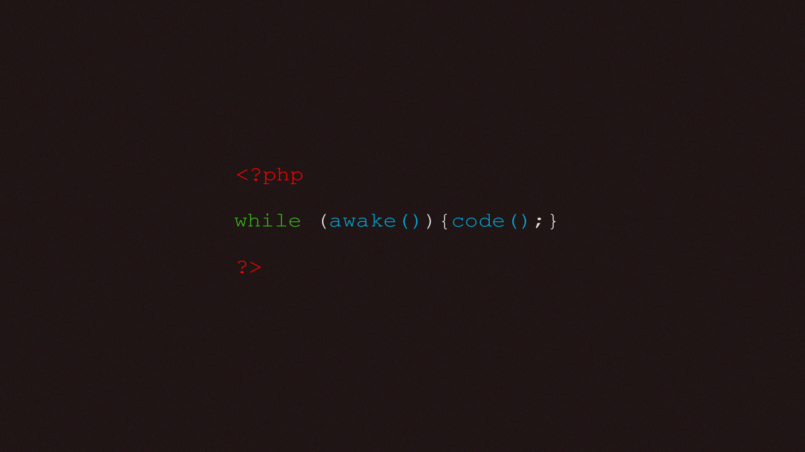

# Introduction to PHP with Composer

## Learnings

### 1. **Variables & Basic Types**

- PHP variables are declared with the `$` prefix
- Strings can be interpolated directly in double quotes: `"2+2: $result"`
- Arrays can be associative (key-value pairs) or indexed
- Variables are dynamically typed

### 2. **Arithmetic Operations**

- Basic operators: `+`, `-`, `*`, `/`, `%` (modulo)
- Operations with numbers and strings work intuitively
- String concatenation can be done with the `.` operator

### 3. **Control Flow - Conditionals**

- `if`, `elseif`, `else` statements for decision-making
- Boolean values: `true` and `false`
- Multiple conditions can be evaluated sequentially
- Logical operators: `&&` (AND), `||` (OR), `!` (NOT)

### 4. **Control Flow - Switch Statements**

- `switch` statements are useful for multiple specific value checks
- Each `case` must end with `break` to avoid fall-through
- `default` case handles all unmatched conditions

### 5. **Loops - For & While**

- `for` loops: ideal for iterating a known number of times
- `while` loops: ideal for conditional iteration
- `foreach` loops: useful for iterating through arrays
- Loop control: `break` exits the loop, `continue` skips to next iteration

### 6. **Object-Oriented Programming**

- Classes are defined with the `class` keyword
- Properties can have visibility modifiers: `public`, `protected`, `private`
- `protected` properties are accessible within the class and its children
- Methods define behaviors for objects
- Classes support inheritance and encapsulation

### 7. **Helper Functions & Code Organization**

- Functions promote code reusability
- They can accept parameters and return values
- Helper functions organize common operations
- Proper function naming makes code self-documenting

### 8. **Composer & Dependency Management**

- `composer.json` defines project configuration and dependencies
- Composer autoload feature simplifies including files
- Dependencies are managed centrally in the `vendor` directory
- This approach keeps projects clean and organized
